  

  
  
  
  

## ⚡ About me

I'm **Alberto Franco Alvarado**, a Systems & Information Engineering student at UPC (Lima, Peru) and a **Process & Automation Analyst at Pacífico Salud**. I take slow, manual work and turn it into automations: Power Automate flows, **Copilot Studio agents that coordinate other agents**, Power Apps and Power BI dashboards that people actually use.

Outside the 9-to-5 I **build and sell websites and web apps** for small businesses, co-founded the perfume e-commerce **Priméssia Parfums**, and spend way too much time reading GPU spec sheets and squeezing extra FPS out of Windows.

- 🔭 **Building:** AI agents for healthcare operations, and my thesis, a deep-learning model that predicts bank customer churn
- 🧠 **Learning:** transformers, LLM agents and AI/cloud certifications
- 💬 **Ask me about:** automating a process end to end, Power Platform, Next.js + FastAPI, or which GPU to buy
- 🎮 **Off the clock:** Valorant (always entry), PC tuning, fragrances

## 🛠️ Tech stack

  

## 🚀 Automation impact

| What I automated | Built with | Result |
|---|---|---|
| Report upload validator for a collections team | VBA · Excel · SQL · BPMN | **−40 h / month** of manual checks |
| Approval app for network access requests | Power Apps · Power Automate · SharePoint | **4 days → 5 hours** per request |
| Smart file-search bot for a projects team | Copilot · Power Automate · SharePoint | Documents found in seconds, not folders |
| Disbursement tracking dashboards | Power BI · DAX · SQL Server | **7× faster** reporting |

## 🧩 Projects

<table>
  <tr>
    <td width="50%" valign="top">
      <h3><a href="https://github.com/Franco-Mator/Fran-Optimizer">⚡ Fran Optimizer</a></h3>
      Native Windows desktop app that boosts FPS and lowers input lag for competitive games. Hardware detection, a restore point before any change, and every tweak can be undone.  
      <code>Python</code> <code>CustomTkinter</code> <code>winreg</code>
    </td>
    <td width="50%" valign="top">
      <h3><a href="https://github.com/Franco-Mator/Mi-blog-CV-">🌐 Personal portfolio</a></h3>
      My CV as a website: experience, automation case studies, certifications and an "off the clock" section, with motion and a hidden easter egg.  
      <code>Next.js 15</code> <code>TypeScript</code> <code>Tailwind v4</code> <code>Framer Motion</code>
    </td>
  </tr>
</table>

**🔒 Private and client work** (code not public):

- **drAIn Flow (thesis):** bank churn prediction with a CNN-BiLSTM + attention model, calibrated probabilities and SHAP explanations, served through FastAPI and tracked with MLflow and DVC.
- **E-commerce and business platforms for clients:** full-stack stores and web apps with Next.js, FastAPI, PostgreSQL and Docker.
- **Incident reporting app** for a mining company.
- **Limited-time import store** with cart-to-WhatsApp checkout, built for mobile shoppers.
- **Priméssia Parfums:** the online store for my own perfume brand.

## 🖥️ Battle station

  

## 🐍 Contribution activity

  <picture>
    <source media="(prefers-color-scheme: dark)" srcset="https://raw.githubusercontent.com/Franco-Mator/Franco-Mator/output/github-snake-dark.svg" />
    <source media="(prefers-color-scheme: light)" srcset="https://raw.githubusercontent.com/Franco-Mator/Franco-Mator/output/github-snake.svg" />
    
  </picture>

  
<b>📜 Certifications</b>

   

- Lean Six Sigma (Tecnológico de Monterrey)
- Scrum Master Professional Certificate, SMPC (CertiProf)
- Google Project Management
- Generative AI Fundamentals (IBM)
- Python for Everybody · SQL for Data Science
- IT Service Portfolio Management (Universidad de los Andes)
- Power BI, intermediate to advanced

  

